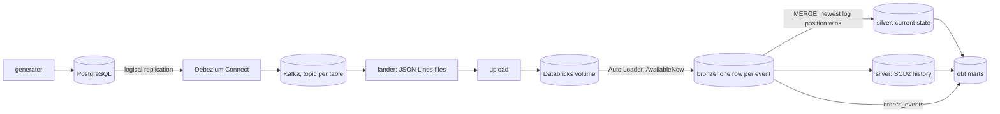

# shop-cdc-lakehouse

A change-data-capture pipeline that copies every insert, update and delete from a PostgreSQL shop database through Debezium and Kafka into a Delta lakehouse on Databricks. It keeps current-state tables and row history, and tests prove that the lakehouse equals the source.

Full documentation, from the source tables to the marts: [docs/DOCUMENTATION.md](docs/DOCUMENTATION.md).

Tools: PostgreSQL 17.12, Debezium 3.7.1, Apache Kafka 4.3.2 (KRaft), Python 3.12, Databricks (serverless jobs, Auto Loader, Delta Lake, Unity Catalog volumes, Asset Bundles), dbt, Docker Compose, GitHub Actions.

The shop data is simulated. No public application database with live changes exists, so a seeded generator (`src/shop/generator.py`) creates realistic activity: orders with items and payments, status changes, refunds, address, email and price changes, and deletes.

## Architecture



The detailed diagram is in [docs/architecture.md](docs/architecture.md). Design choices, rejected options and interview answers are in [docs/EXPLAIN.md](docs/EXPLAIN.md).

## Measured results

Two runs on a MacBook with 8 GiB of memory ([machine-memory.txt](docs/evidence/machine-memory.txt)), with a Docker VM of 3,916 MiB and 3 CPUs ([b0-t8-docker.txt](docs/evidence/b0-t8-docker.txt)), and Databricks Free Edition. Every Databricks run is listed in [docs/run-ledger.md](docs/run-ledger.md).

- Run A, 100,000 changes, 16 Nov 2026, in the schemas `shop_bronze` and `shop_silver` (`docs/evidence/b6-*`, `docs/evidence/b8-latency.json`, `docs/evidence/b10/f1-*`, `docs/evidence/b10/8-dbt-build-100k.txt`).
- Run B, 1,000,000 changes, generated and landed on 16 Nov, processed on 17 Nov, in the schemas `shop_1m_bronze` and `shop_1m_silver`: the scale run, and a fresh check of the proof code after the review fixes (`docs/evidence/stretch-1m-*`, `docs/evidence/b10/1m-*`).

### Run A: 100,000 changes

| What | Result | Evidence |
|---|---|---|
| Change events generated | 100,000: 53,409 inserts, 38,454 updates, 8,137 deletes | [b6-generator-report.json](docs/evidence/b6-generator-report.json) |
| Events landed as files | 100,000 in 111 files | [b6-main-run.json](docs/evidence/b6-main-run.json) |
| Upload of the files that were not yet uploaded | 89 files in 53.5 s (22 already there were skipped) | [b6-main-run.json](docs/evidence/b6-main-run.json) |
| Pipeline job (bronze, silver, history) | 203.7 s | [b6-main-run.json](docs/evidence/b6-main-run.json) |
| Reconciliation with PostgreSQL | all 5 tables equal: customers 2,427, products 658, orders 9,648, order_items 22,891, payments 9,648 rows; 0 differing row hashes | [b6-reconcile.json](docs/evidence/b6-reconcile.json) |
| Reconciliation can fail | one changed row in a copy is reported as exactly that row | [b6-reconcile-canfail.json](docs/evidence/b6-reconcile-canfail.json) |
| Replay: drop silver, rebuild from bronze | identical table hashes for all 5 tables; rebuild job 65.4 s | [b6-replay.json](docs/evidence/b6-replay.json) |
| Disorder: newest third, then oldest third, then middle third plus a re-delivered file | identical table hashes for all 5 tables | [b6-disorder.json](docs/evidence/b6-disorder.json), [b6-disorder-batch-log.json](docs/evidence/b6-disorder-batch-log.json) |
| Disorder test can fail ("apply only if newer" switched off) | differences in all 5 tables, e.g. 2,767 orders and 1,268 customers | [b6-disorder-canfail.json](docs/evidence/b6-disorder-canfail.json) |
| History (SCD2) | 8,401 customer versions and 4,482 product versions, equal to the counts expected from the generator; no overlapping intervals; one current row per live key | [b6-history-check.json](docs/evidence/b6-history-check.json) |
| Order status funnel, orders that ever reached each step (corrected 17 Nov) | placed 11,061, paid 6,849, shipped 5,276, delivered 4,438; ever cancelled 1,946 | [f1-funnel-old-vs-new.txt](docs/evidence/b10/f1-funnel-old-vs-new.txt) |
| End-to-end delay, one database commit to the silver table | 69.7 s: capture 0.45 s, lander 0.13 s, upload 5.75 s, job run 63.35 s | [b8-latency.json](docs/evidence/b8-latency.json) |

Earlier checks on the development run (5,000 generated events plus 4 from the capture test, [b4-b5-notes.md](docs/evidence/b4-b5-notes.md)): an orders file delivered again under a new name brought its 1,528 events into the batch again and added 0 bronze rows ([b4-bronze-dedup.json](docs/evidence/b4-bronze-dedup.json)); a lander re-run over the same offsets gave the same 5 files with the same SHA-256 hashes ([b3-lander-rerun.txt](docs/evidence/b3-lander-rerun.txt)); an insert, an update and a delete were each captured ([b2-capture.txt](docs/evidence/b2-capture.txt)).

The first attempt at Run A hung for about 33 minutes inside one upload request that had no timeout. It was stopped and resumed at the upload step, which is safe to repeat; nothing was regenerated ([b6-main-run.json](docs/evidence/b6-main-run.json)). On 17 Nov an upload hung again until it was stopped, although request timeouts were set by then. The cause: the Databricks SDK's experimental Files client sends uploads through worker threads that did not apply those timeouts. The client is now switched off (`disable_experimental_files_api_client`), so uploads use the plain Files API call with a 60-second timeout and at most three attempts per file.

### Run B: 1,000,000 changes

| What | Result | Evidence |
|---|---|---|
| Change events generated | 1,000,000: 526,227 inserts, 389,385 updates, 84,388 deletes | [stretch-1m-generator-report.json](docs/evidence/stretch-1m-generator-report.json) |
| Captured and landed | 1,084,388 Kafka records (1,000,000 events + 84,388 tombstones); 1,000,000 events in 220 files; lag 0 | [stretch-1m-local-state.txt](docs/evidence/stretch-1m-local-state.txt) |
| Pipeline job (bronze, silver, history) | 226.3 s | [stretch-1m-main-run.json](docs/evidence/stretch-1m-main-run.json) |
| Reconciliation with PostgreSQL | all 5 tables equal: customers 25,095, products 6,855, orders 94,094, order_items 221,701, payments 94,094 rows; 0 differing row hashes | [1m-reconcile.json](docs/evidence/b10/1m-reconcile.json) |
| Reconciliation can fail | one changed row in a copy is reported as exactly that row | [1m-reconcile-canfail.json](docs/evidence/b10/1m-reconcile-canfail.json) |
| Merge oracle: pure-Python model of the merge rule built from the landing files | identical table hashes for all 5 silver tables, delete marks and `_lsn` included | [1m-oracle.json](docs/evidence/b10/1m-oracle.json) |
| Replay: drop silver, rebuild from bronze | identical table hashes for all 5 tables, each table recreated during the run; rebuild job 55.8 s | [1m-replay.json](docs/evidence/b10/1m-replay.json) |
| Disorder: newest third, oldest third, then middle third plus a re-delivered file | identical table hashes for all 5 tables; duplicates reached the merge (orders run 3: 109,785 events in the batch, 105,005 new in bronze) | [1m-disorder.json](docs/evidence/b10/1m-disorder.json), [1m-disorder-batch-log.json](docs/evidence/b10/1m-disorder-batch-log.json) |
| Disorder test can fail ("apply only if newer" switched off) | differences in all 5 tables, e.g. 26,677 orders and 12,555 customers; the merge oracle also reports all 5 tables as different | [1m-disorder-canfail.json](docs/evidence/b10/1m-disorder-canfail.json), [1m-oracle-canfail.json](docs/evidence/b10/1m-oracle-canfail.json) |
| Batch guard: a planted event without an operation, one without a log position and one without a key, each in its own run on separate 2-event schemas (17 Nov) | each job fails with the guard's message and stores 0 rows | [guard-check-three-cases.json](docs/evidence/guard-check-three-cases.json); first run, no operation only: [f12-guard-check.json](docs/evidence/b10/f12-guard-check.json) |
| History (SCD2), five checks | 86,208 customer versions and 45,462 product versions, equal to the expected counts; no overlaps; one current row per live key; current rows equal silver on every tracked column | [1m-history-check.json](docs/evidence/b10/1m-history-check.json) |

The acceptance checks and their evidence are listed in [docs/acceptance-checks.md](docs/acceptance-checks.md). Unit tests, lint, dbt and the other checks were run again after the review fixes: [b10-verification.txt](docs/evidence/b10-verification.txt).

## How it works

1. PostgreSQL writes every change to its write-ahead log. Debezium reads it through `pgoutput` and publishes one Kafka topic per table. Decimals arrive as exact strings and timestamps as UTC strings with microseconds.
2. The lander writes Kafka records to JSON Lines files named by topic, partition and offset range, and commits offsets only after the file is safely on disk. Tombstones are skipped and counted.
3. The upload copies new files to `LANDING_ROOT/shop/<table>/` in a Unity Catalog volume. `LANDING_ROOT` is set only in `conf/shop.toml`.
4. The Databricks job reads new files with Auto Loader (`Trigger.AvailableNow`). Each batch is stored in bronze once per Kafka record (partition and offset), and the whole batch goes to the silver MERGE, which applies an event only if its PostgreSQL log position is newer than the stored row. Deletes stay as rows with a delete mark (`_deleted = true`), so a late event cannot bring a key back.
5. History tables for customers and products are rebuilt from bronze, ordered by log position.
6. dbt builds daily revenue, the order status funnel, and revenue by customer country and city as they were at order time.

## How to run it

Prerequisites: Docker, `uv`, the Databricks CLI, and a Databricks workspace with a SQL warehouse and a Unity Catalog catalog you can create schemas in.

Settings:
1. `conf/shop.toml`: the catalog, `landing_root` (the volume path the files are uploaded to) and `checkpoints` (the volume path for Auto Loader checkpoints). `make deploy` passes them to the bundle and `scripts/with-secrets.sh` exports the catalog for dbt; `databricks.yml` holds the catalog and the checkpoint path as defaults and the dbt files hold the catalog; the landing root has no default.
2. A secrets file with `DATABRICKS_HOST="https://<workspace>"` and `DATABRICKS_TOKEN="<personal access token>"`. Keep it out of the repository; the default is `.env` in the repository root, which is gitignored.
3. `conf/local.env` (copy `conf/local.env.example`; gitignored): `SHOP_SECRETS_FILE` (path to the secrets file) and `SHOP_WAREHOUSE_HTTP_PATH` (SQL warehouse > Connection details). `scripts/with-secrets.sh` loads both for every command that needs Databricks.

```bash
uv sync --locked
scripts/with-secrets.sh uv run python scripts/setup_databricks.py   # landing schema and the two volumes
make up                         # PostgreSQL, Kafka, Debezium Connect
make connector                  # register (or update) the Debezium connector
make generate EVENTS=5000       # simulated shop activity
sleep 30                        # let Debezium publish the last events before landing
PYTHONPATH=src uv run python -m shop.lander --landing landing --block 50   # Kafka -> landing/ files (events captured so far; run again for newer ones)
make deploy                     # deploy the Databricks job (bundle), with values from conf/shop.toml
scripts/with-secrets.sh uv run python scripts/run_pipeline.py --prefix shop --bronze shop_bronze --silver shop_silver --events 5000
scripts/with-secrets.sh uv run python -m shop.reconcile --catalog <catalog>
scripts/with-secrets.sh uv run dbt build --project-dir dbt --profiles-dir dbt
make ci                         # lint, unit tests, dbt parse
make down
```

The lander prints a JSON summary; its line `"events_in_files": 5000,` shows that all 5,000 events were landed. If the number is lower, Debezium had not yet published every event: run the lander command again. It continues from the offsets it committed and lands only the events it has not landed yet, so the numbers of both runs add up to 5,000.

This block, with the section 7 proof commands run before `make down`, was run once on 17 Nov 2026, from an empty database and an empty catalog; every command exited 0 and every proof passed ([run-5000-how-to-run.txt](docs/evidence/run-5000-how-to-run.txt)). The lander command above writes 50 offsets per file so that each table has at least 3 files, which `scripts/disorder_test.py` needs; `make land` runs the same lander with the default of 2,000 offsets per file. The proof commands for a 5,000-event run are in [docs/DOCUMENTATION.md](docs/DOCUMENTATION.md), section 7.

The proof scripts are `python -m shop.reconcile`, `scripts/reconcile_canfail.py`, `scripts/replay_test.py`, `scripts/disorder_test.py`, `scripts/guard_check.py`, `python -m shop.history_check` and `python -m shop.oracle`. Each exits with a non-zero code when its check fails. `scripts/b6_main.py` runs a whole main run (generate, capture, land, upload, job) and times each step.

## Known limits

- The data is simulated.
- The lander runs on the laptop, because the Kafka broker is published only on the laptop's `127.0.0.1` (`docker-compose.yml`) and Databricks cannot read it.
- The lakehouse side runs as incremental batches that are started by hand (`scripts/run_pipeline.py` or the Databricks job page), not on a schedule and not as continuous streaming. The job has no schedule; serverless jobs allow only the `AvailableNow` trigger and the deprecated `Once` trigger.
- The catalog is `analytics`: the warehouse reports a default catalog named `workspace`, which does not exist in this account.
- All generated orders fall on one day, so `daily_revenue` has one row ([b7-dbt-build.txt](docs/evidence/b7-dbt-build.txt), Mart samples).
- Landing file names and the bronze key come from Kafka offsets. If the topics were deleted and created again, offsets would restart at 0 and new events with reused offsets would be skipped. No run here recreated a topic ([docs/EXPLAIN.md](docs/EXPLAIN.md), section Upload).
- `valid_from` and `valid_to` in the history tables are transaction commit times; versions written in one transaction share a time. Use `valid_from_lsn` and `valid_to_lsn` for exact ordering.
- Two dbt staging models read raw JSON from bronze (the insert log position of an order, and the funnel's status path) instead of silver.
- The marts are full table rebuilds, which is fine at this size.
- The CI workflow (`.github/workflows/ci.yml`) runs on every push and pull request, but only lint, unit tests and `dbt parse`, without Databricks access; its first run on GitHub, on 17 Nov 2026, passed (see the repository's Actions tab).

## How this project was built

I built this project with AI assistance (Claude Code). I set the goal and the constraints, approved the design and directed the work. AI agents wrote the code, which then went through an independent code review; its findings are fixed or listed under Known limits. Each measured result in this README names its source, usually a file in `docs/evidence/`.

## License

The code is released under the MIT License; see [LICENSE](LICENSE). The source data is simulated by this project's own generator, so no third-party data is included.
