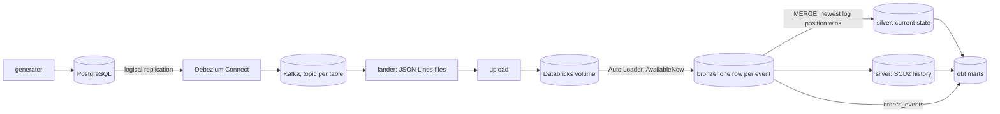
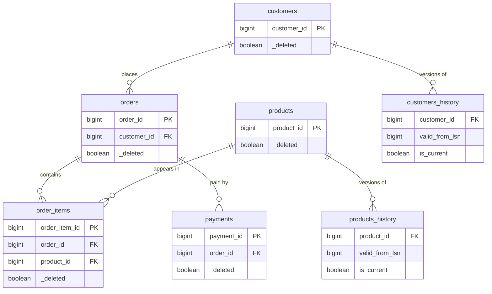

# shop-cdc-lakehouse: project documentation

This document follows one change from the source database to a mart row. Measured numbers live in the [README](../README.md); the reasoning behind each design choice lives in [EXPLAIN.md](EXPLAIN.md).

## 1. Overview and problem statement

An online shop keeps its orders, customers, products and payments in PostgreSQL. Analysts need the same data in a lakehouse, kept current as rows are inserted, updated and deleted, with a history of customer and product attributes so that revenue can be reported by the customer's city and country at the time of each order. A nightly full copy would miss every version that exists only between two copies and would not record when a row was deleted, so the pipeline captures every row-level change from the database log instead.

Goal: a lakehouse whose current-state tables equal the source tables row for row, and which stays correct when change events arrive late, out of order or more than once.

In scope:

- capture of inserts, updates and deletes on five tables;
- landing of the change events as files and their upload to a Databricks volume;
- a bronze event table, silver current-state tables and slowly changing dimension type 2 (SCD2) history tables;
- three dbt marts;
- proofs that the lakehouse equals the source.

Out of scope: a real shop application, continuous streaming, scheduling, multi-partition topics, schema evolution of the source tables, and serving or dashboard layers.

## 2. Data sources

The source is a PostgreSQL database named `shop` with five tables, defined in [db/schema.sql](../db/schema.sql). Every table has a `bigint` primary key and an `updated_at` column that the database sets: a default on insert and a trigger on update.

| Table | Primary key | Columns |
|---|---|---|
| `customers` | `customer_id` | name, email, city, country, created_at, updated_at |
| `products` | `product_id` | name, category, price `numeric(10,2)`, updated_at |
| `orders` | `order_id` | customer_id, status, ordered_at, updated_at |
| `order_items` | `order_item_id` | order_id, product_id, quantity, unit_price `numeric(10,2)`, updated_at |
| `payments` | `payment_id` | order_id, amount `numeric(12,2)`, method, status, updated_at |

The data is simulated. No public application database with live changes exists, so [src/shop/generator.py](../src/shop/generator.py) creates the activity. `plan(seed, n)` is a pure function that returns exactly `n` row-level changes for a seed. It creates products and customers first, then picks weighted actions: new orders with items and a payment, payment capture, shipping and delivery, cancellations with refunds, item removal, purging of cancelled orders, email, address and price changes, new customers and products, and deletes of customers without orders. `apply()` runs the plan against PostgreSQL, one statement per change, fails if a statement does not touch exactly one row, and commits every 500 statements. One change is therefore one change event.

The publication `shop_pub` lists exactly these five tables, and the connector is configured not to create its own.

## 3. Architecture



This is the README diagram. [architecture.md](architecture.md) has a detailed version with file names, schemas and the reconciliation path.

A customer's city change travels as follows:

1. The generator runs `UPDATE customers SET city = ...`. PostgreSQL, running with `wal_level=logical`, writes the change to its write-ahead log.
2. Debezium reads the log through the `pgoutput` plugin and publishes a JSON event to the topic `shop.public.customers`. The event carries the new row (`after`), the operation `u` and the log position `source.lsn`.
3. The lander on the laptop reads the topic and writes the event into a JSON Lines file under `landing/customers/`. After the file is on disk, the lander commits the Kafka offset.
4. The upload copies new files to `LANDING_ROOT/shop/customers/` in a Unity Catalog volume.
5. The Databricks job `shop_pipeline` reads new files with Auto Loader. It stores the event in `shop_bronze.customers_events` and merges it into `shop_silver.customers` if its log position is newer than the stored row's. The job's second task rebuilds `shop_silver.customers_history`, where the change closes the old version and opens a new one.
6. `dbt build` rebuilds the marts. Orders inserted after the change are counted under the new city in `revenue_by_customer_attributes`, and earlier orders stay under the old city.

## 4. Technology stack

| Tool | Version | Pinned in | Job here |
|---|---|---|---|
| PostgreSQL | 17.12 (`postgres:17.12-alpine`) | `docker-compose.yml` | Source database with logical replication |
| Debezium Connect | 3.7.1 (`quay.io/debezium/connect:3.7.1.Final`) | `docker-compose.yml` | Reads the write-ahead log, publishes change events |
| Apache Kafka | 4.3.2 (`apache/kafka:4.3.2`), KRaft mode | `docker-compose.yml` | One topic per table, one partition each |
| Python | 3.12 | `.python-version` | Generator, lander, upload, proofs |
| uv | 0.13.1 | `.github/workflows/ci.yml` | Environment and lock file |
| confluent-kafka | 2.16.1 | `uv.lock` | Kafka consumer in the lander |
| psycopg | 3.3.9 | `uv.lock` | Generator writes; source side of reconciliation |
| databricks-sdk | 0.117.0 | `uv.lock` | File upload, job runs |
| databricks-sql-connector | 4.4.0 | `uv.lock` | SQL queries for the proofs |
| dbt-core / dbt-databricks | 1.12.6 / 1.13.0 | `uv.lock` | Marts and data tests |
| pytest / ruff | 9.2.0 / 0.17.5 | `uv.lock` | Unit tests, lint |
| Databricks serverless jobs | environment version 4 | `databricks.yml` | Runs `jobs/pipeline.py` and `jobs/history.py` (PySpark, Auto Loader, Delta Lake) |
| Databricks Asset Bundles | bundle `shop-cdc-lakehouse` | `databricks.yml` | Deploys the job |
| GitHub Actions | `actions/checkout` v7.0.1, `astral-sh/setup-uv` v10.3.3, pinned by commit SHA | `.github/workflows/ci.yml` | Runs `make ci` |

The Databricks CLI deploys the bundle. The repository does not pin its version; v1.26.0 was used ([b0-t8-docker.txt](evidence/b0-t8-docker.txt)).

## 5. Data model

### Change event

Debezium sends each change as a Kafka record. The key is the primary key as JSON, for example `{"customer_id":900001}`. The value has `before`, `after`, `source` and `op`. A sample insert, update and delete is in [b2-capture.txt](evidence/b2-capture.txt). The lander writes one line per record that has a value:

```json
{"kafka_topic": "shop.public.customers", "kafka_partition": 0, "kafka_offset": 1,
 "kafka_key": "{\"customer_id\":900001}", "payload": "<the Debezium value, unchanged>"}
```

The pipeline reads these fields from the payload:

| Field | Use |
|---|---|
| `op` | `c` insert, `u` update, `d` delete, `r` snapshot read |
| `source.lsn` | PostgreSQL log position; orders all events of a key |
| `source.txId` | Source transaction id, stored in bronze |
| `source.ts_us` | Commit time in microseconds; becomes `source_ts` |
| `after.*` | New row values; NULL for a delete |

Decimals arrive as exact strings (`decimal.handling.mode=string`) and timestamps as UTC strings with microseconds. For a delete, the pipeline takes the key from the Kafka key and ignores `before`, whose non-key columns hold placeholders under the default replica identity. Debezium follows each delete with a tombstone (a record with a null value), which the lander skips and counts.

### Tables and grain

| Layer | Table | Grain | Key |
|---|---|---|---|
| Bronze | `shop_bronze.<table>_events` (5 tables) | One row per change event (a Kafka record with a value; tombstones never reach bronze) | `(kafka_partition, kafka_offset)` |
| Bronze | `shop_bronze._batch_log` | One row per micro-batch and table | None; append-only log with `logged_at` |
| Silver | `shop_silver.<table>` (5 tables) | One row per primary key ever seen; a deleted key keeps its row with a delete mark (`_deleted = true`) | Source primary key |
| Silver | `shop_silver.customers_history`, `shop_silver.products_history` | One row per version of the tracked columns | `(<primary key>, valid_from_lsn)` |
| Marts | `shop_marts.daily_revenue` | One row per order date | `order_date` |
| Marts | `shop_marts.order_status_funnel` | One row per status | `status` |
| Marts | `shop_marts.revenue_by_customer_attributes` | One row per country and city | `(country, city)` |

Schema names are the defaults in `databricks.yml`, `dbt/models/sources.yml` and `dbt/profiles.yml`; Run B used `shop_1m_bronze`, `shop_1m_silver` and `shop_1m_marts`. The catalog comes from `conf/shop.toml`. The tracked columns are name, email, city and country for customers, and name, category and price for products (`jobs/history.py`).

Delta tables have no foreign-key constraints. In the diagram, the lines between silver tables are the source's foreign keys (`db/schema.sql`), and each history table joins its silver table on the primary key. dbt checks two relationships: `stg_orders.customer_id` against `stg_customers_history`, and `stg_order_items.order_id` against `stg_orders`. The diagram shows keys only; the column dictionary lists every column:



### Column dictionary

Names and types come from `DESCRIBE TABLE` on the warehouse, saved in [describe-tables.txt](evidence/describe-tables.txt). The bronze, silver and history types are the ones declared in `jobs/pipeline.py` (`TABLES`, `ensure_tables`) and `jobs/history.py`; the mart types are the ones Spark derives from the dbt SQL (for example, a sum of `quantity * unit_price` is `decimal(31,2)`). Meanings come from the same files and from `dbt/models/schema.yml`.

Bronze event tables (`shop_bronze.<table>_events`; all five have these columns, shown for `orders_events`):

| Column | Type | Meaning |
|---|---|---|
| `kafka_topic` | string | Kafka topic |
| `kafka_partition` | int | Kafka partition |
| `kafka_offset` | bigint | Kafka offset |
| `kafka_key` | string | Kafka key as JSON text |
| `payload` | string | Debezium value, unchanged |
| `op` | string | `op` from the payload |
| `source_lsn` | bigint | `source.lsn` |
| `source_tx_id` | bigint | `source.txId` |
| `source_ts` | timestamp | `source.ts_us` as a timestamp |
| `file_name` | string | Path of the landing file |
| `ingested_at` | timestamp | Time the batch was processed |

Batch log (`shop_bronze._batch_log`, one row per micro-batch and table, written by `run_table` in `jobs/pipeline.py`):

| Column | Type | Meaning |
|---|---|---|
| `table` | string | Source table of the batch |
| `batch_id` | bigint | Micro-batch number from Auto Loader |
| `events_in_batch` | bigint | Events that reached the batch, duplicates included |
| `distinct_events` | bigint | Distinct `(kafka_partition, kafka_offset)` pairs in the batch |
| `bronze_rows_added` | bigint | Rows bronze gained from the batch |
| `files` | array<string> | Names of the landing files in the batch |
| `require_newer` | boolean | False when the run used `--no-require-newer` |
| `logged_at` | timestamp | Time the row was written |

Silver current-state tables. The data columns have the source names; the last three columns are added by the merge:

| Table | Data columns and types |
|---|---|
| `customers` | `customer_id` bigint, `name` string, `email` string, `city` string, `country` string, `created_at` timestamp, `updated_at` timestamp |
| `products` | `product_id` bigint, `name` string, `category` string, `price` decimal(10,2), `updated_at` timestamp |
| `orders` | `order_id` bigint, `customer_id` bigint, `status` string, `ordered_at` timestamp, `updated_at` timestamp |
| `order_items` | `order_item_id` bigint, `order_id` bigint, `product_id` bigint, `quantity` int, `unit_price` decimal(10,2), `updated_at` timestamp |
| `payments` | `payment_id` bigint, `order_id` bigint, `amount` decimal(12,2), `method` string, `status` string, `updated_at` timestamp |

| Column (every silver table) | Type | Meaning |
|---|---|---|
| `_lsn` | bigint | Log position of the event that last wrote the row |
| `_deleted` | boolean | True when that event was a delete; the columns other than the primary key are then NULL |
| `_source_ts` | timestamp | Commit time of that event (`source.ts_us`) |

History tables. The key and tracked columns are as in silver:

| Table | Key and tracked columns |
|---|---|
| `customers_history` | `customer_id` bigint, `name` string, `email` string, `city` string, `country` string |
| `products_history` | `product_id` bigint, `name` string, `category` string, `price` decimal(10,2) |

| Column (both history tables) | Type | Meaning |
|---|---|---|
| `valid_from` | timestamp | Commit time of the event that started the version |
| `valid_to` | timestamp | Commit time of the event that ended it; NULL for a version that has not ended |
| `valid_from_lsn` | bigint | Log position that started the version |
| `valid_to_lsn` | bigint | Log position of the next version or the delete; NULL if none |
| `is_current` | boolean | True when `valid_to_lsn` is NULL |

Marts:

| Mart | Column | Type | Meaning |
|---|---|---|---|
| `daily_revenue` | `order_date` | date | Date of `ordered_at` |
| `daily_revenue` | `orders` | bigint | Live orders that are not cancelled and have at least one live line |
| `daily_revenue` | `revenue` | decimal(31,2) | Sum of `quantity * unit_price` over those lines |
| `order_status_funnel` | `status` | string | placed, paid, shipped, delivered or cancelled |
| `order_status_funnel` | `step` | int | 1 to 4 in funnel order; 9 for cancelled |
| `order_status_funnel` | `orders_now_in_status` | bigint | Live orders whose current status is this one |
| `order_status_funnel` | `orders_reached_step` | bigint | Orders that ever reached this step, cancelled and purged orders included; for cancelled, orders that were ever cancelled |
| `revenue_by_customer_attributes` | `country` | string | Customer's country when the order was inserted |
| `revenue_by_customer_attributes` | `city` | string | Customer's city when the order was inserted |
| `revenue_by_customer_attributes` | `orders` | bigint | Live orders that are not cancelled, have at least one live line and fall inside a version of their customer |
| `revenue_by_customer_attributes` | `revenue` | decimal(31,2) | Sum of `quantity * unit_price` over their live lines |

## 6. Pipeline design

| Stage | Input | Output | Incremental rule | Rerun, late or duplicate event |
|---|---|---|---|---|
| Capture | Write-ahead log of the tables in `shop_pub` | Topics `shop.public.<table>`, one partition each, kept forever (`KAFKA_LOG_RETENTION_HOURS: -1`) | The replication slot `shop_slot` remembers how far Debezium has read. On first start it snapshots existing rows (`snapshot.mode=initial`, `op = r`). | If Connect sends an event again after a restart, the copy gets a new offset. Bronze stores both copies, silver ignores the copy because its `lsn` is not newer, and the history build removes it with `SELECT DISTINCT`. |
| Landing (`src/shop/lander.py`) | Each topic from the consumer group's committed offset (group `shop-lander`) to the end offset seen when the run starts | `landing/<table>/<topic>__p<partition>__<first>-<last>.jsonl`, cut at fixed offset blocks (`--block`, default 2,000; Run A used 1,000, [run-a-landing-files.txt](evidence/run-a-landing-files.txt), and Run B 5,000, [stretch-1m-local-state.txt](evidence/stretch-1m-local-state.txt)) | Offsets are committed only after a file is written to a temporary name, fsynced and renamed. | A rerun over the same offsets writes the same names and bytes. An existing file with identical bytes is left alone; different bytes stop the run. If new events join a block after part of it was written (a crash before the commit, or a consumer-group reset to the start), the next run writes an overlapping file under a new name, and bronze stores each event once. |
| Upload (`src/shop/upload.py`) | `landing/<table>/*.jsonl` | `LANDING_ROOT/shop/<table>/` in the volume; `LANDING_ROOT` is set in `conf/shop.toml` | Remote names that already exist are skipped. | A name always stands for the same bytes, so skipping is safe. A retry after a failed attempt overwrites with the same bytes. |
| Bronze (`jobs/pipeline.py`) | New files in `<landing>/<table>/`, found by Auto Loader with `Trigger.AvailableNow` | `<table>_events`, plus one `_batch_log` row per batch | The Auto Loader checkpoint (`<checkpoints>/<bronze schema>/<table>`) lists the files already read. | `dropDuplicates` and a MERGE on `(kafka_partition, kafka_offset)` insert an event only once. A file delivered again under a new name adds no rows. |
| Silver merge (`merge_silver`) | The whole micro-batch, duplicates and late events included | `<table>` with `_lsn`, `_deleted`, `_source_ts` | Within the batch the newest event per key wins (`row_number` over `_lsn` descending). The MERGE updates a stored row only `WHEN MATCHED AND s._lsn > t._lsn`. | A duplicate or older event has an `lsn` that is not newer, so it changes nothing. A delete is stored as a row with a delete mark and its `lsn`, so a late insert for that key cannot bring it back. |
| History (`jobs/history.py`) | All of bronze for customers and products | `<table>_history` | None: `CREATE OR REPLACE TABLE` rebuilds it on every job run. | Events are ordered by `source_lsn`, not by arrival, and `SELECT DISTINCT` drops repeated events, so arrival order and duplicates do not change the result. |
| Marts (`dbt/`) | Silver, history and `shop_bronze.orders_events` | Three tables in `shop_marts`; staging models are views | None: each mart is a full table rebuild. | The marts are functions of their inputs, so a rebuild gives the same rows. `stg_orders` takes the minimum insert `lsn` per order and `stg_order_steps` the maximum step, so repeated bronze events do not change them. |

Ordering by `lsn` per key is safe with concurrent transactions: a second change to a row waits for the first change's row lock, so its log record comes after the first commit. [EXPLAIN.md](EXPLAIN.md#silver-current-state-jobspipelinepy-merge_silver) gives the full argument.

A history version starts at an insert or snapshot read, at an update that changes a tracked column, at an update that follows a delete, or at an update with no earlier event for the key; it ends at the next version or at the delete (`boundaries` in `jobs/history.py`). The generator produces only the first two kinds. `revenue_by_customer_attributes` joins each order to the customer version whose `[valid_from_lsn, valid_to_lsn)` range holds the order's insert `lsn`. It uses log positions because `valid_from` and `valid_to` are commit times, and the generator commits 500 statements per transaction.

## 7. Data quality and testing

### Batch guard

Before anything is stored, `check_required_fields` in `jobs/pipeline.py` counts events whose `op` is NULL or not one of `c`, `u`, `d`, `r`, whose `source_lsn` is NULL, or whose Kafka key is NULL. If any exist, the batch raises an error, the job fails, and nothing of that batch reaches bronze or silver. `scripts/guard_check.py` proves this for each condition: it plants an event without an operation, one without a log position and one without a key, each with one valid event in its own run and its own pair of schemas, and exits 0 only when every job fails with the guard's message and stores 0 rows ([guard-check-three-cases.json](evidence/guard-check-three-cases.json)).

### Proofs against the source

| Proof | What it proves | What it does not prove |
|---|---|---|
| Reconciliation (`python -m shop.reconcile`) | Each silver table, without the rows that have a delete mark, equals its PostgreSQL table: equal row counts and equal row hashes by key. Every column is turned into one canonical text form first. An empty source fails. `scripts/reconcile_canfail.py` changes one row in a copy of silver `customers` and expects exactly that row to be reported. | That the history tables or marts are correct. |
| Replay (`scripts/replay_test.py`) | Dropping silver and rebuilding it from bronze (`--rebuild-silver`) gives identical table hashes, delete marks and `_lsn` included, and each table was recreated during the run. Bronze therefore holds everything silver needs. | The "apply only if newer" rule against stored rows, because the rebuild merges into empty tables. |
| Disorder (`scripts/disorder_test.py`) | Feeding each table's files, in separate schemas, in three runs (newest third, oldest third, middle third plus a re-delivered file) gives the same table hashes as the in-order run. With `--no-require-newer` the same test must report differences. | Disorder inside one micro-batch, where the in-batch `row_number` decides; the merge oracle checks the final tables against the rule. |
| Merge oracle (`python -m shop.oracle`) | A pure-Python model of the merge rule, built from the landing files, gives the same table hashes as silver. | The history tables and marts, since it checks silver only; events lost or changed before the landing files, because it reads the same files as the pipeline. |
| History checks (`python -m shop.history_check`) | Intervals chain without gaps or overlaps; each live key has exactly one current row and each deleted key none; versions per key equal the count from the generator plan; each current row equals silver on the tracked columns. | Anything about the commit-time columns `valid_from` and `valid_to`; versions written in one transaction share a time. |

Only reconciliation compares the lakehouse with PostgreSQL, so it is the only proof that can find an event lost or changed before the landing files. No proof compares `_source_ts`: reconciliation compares the source columns, and replay, disorder and the oracle hash the source columns plus `_lsn` and `_deleted`. Every proof script exits with a non-zero code when its check fails.

### dbt tests

`dbt/models/schema.yml` declares these generic tests: `unique` and `not_null` on `stg_orders.order_id`, `stg_order_items.order_item_id`, `stg_order_steps.order_id`, `daily_revenue.order_date` and `order_status_funnel.status`; `not_null` on `stg_orders.created_lsn`, `stg_orders.customer_id`, `stg_order_items.order_id` and `revenue_by_customer_attributes.country`; and `relationships` from `stg_orders.customer_id` to `stg_customers_history` and from `stg_order_items.order_id` to `stg_orders`. Four singular tests in `dbt/tests/` check that:

- every live order falls inside exactly one customer version;
- the funnel's "placed" count equals the number of orders ever inserted, and steps 1 to 4 do not increase;
- `revenue_by_customer_attributes` has one row per country and city;
- the two revenue marts have the same total, and a NULL total fails.

### Unit tests

`tests/` covers the generator (determinism, exact counts, foreign-key consistency), the lander (file names, block cuts, byte-identical reruns, commit order with a fake consumer, crash and deadline), the upload retry, the reconciliation canonical forms and the empty-source rule, and the merge oracle. None of them needs Docker or Databricks.

### How to run

```bash
make ci                                                   # ruff, pytest, dbt parse
scripts/with-secrets.sh uv run dbt build --project-dir dbt --profiles-dir dbt
scripts/with-secrets.sh uv run python -m shop.reconcile --catalog <catalog>
scripts/with-secrets.sh uv run python scripts/replay_test.py
scripts/with-secrets.sh uv run python scripts/disorder_test.py --tag dis --reference shop_silver
scripts/with-secrets.sh uv run python -m shop.oracle --landing landing --silver shop_silver
scripts/with-secrets.sh uv run python -m shop.history_check --silver shop_silver --seed 42 --events 5000
```

`--events` and `--seed` must match the values used by `make generate`. `scripts/verify.sh <evidence dir> <summary file>` reruns `make ci`, the secret scan with a planted token, the lander rerun, `dbt build` on the Run A and Run B schemas, the connector registration (twice), an insert, update and delete capture, and a README link check, and writes one result line per check. It needs the local stack and the Databricks settings.

## 8. Orchestration and operations

A person starts each run; the job has no schedule. The order is:

1. `make up`, `make connector`: start PostgreSQL, Kafka and Connect, and register the connector.
2. `make generate`: apply the plan to PostgreSQL.
3. The lander (`make land`, or the `--block 50` command in section 9 when the disorder test will run): write the events captured so far to `landing/`.
4. `scripts/run_pipeline.py`: upload new files, then run the job `shop_pipeline` and wait. The job runs the task `bronze_silver` and then `history`. It allows two concurrent runs.
5. `dbt build`, then the proofs.

`scripts/b6_main.py` runs the generator, waits until Kafka holds every expected record, runs the lander, the upload and the job, and times each step. It expects an empty database. The reconciliation is a separate step.

Time limits and retries:

| Step | Limit |
|---|---|
| Connect start (`scripts/wait_for_connect.sh`) | Up to 40 tries, 3 s apart, each with a 3 s request limit (120 to 240 s in total) |
| Lander | Fails if it has not reached the end offsets within 900 s (`max_seconds`) |
| Databricks requests (`src/shop/dbx.py`) | 60 s HTTP timeout, 180 s retry timeout; the SDK's experimental Files client is switched off because its upload path did not apply the timeout |
| Upload, per file | At most 3 attempts, 5 s and 10 s apart |
| Job run | `run_job` waits at most 40 minutes |
| dbt | `connect_timeout: 60`, `connect_retries: 2` |
| GitHub Actions | `timeout-minutes: 15` |

Recovery from a failed run. Every step after the generator is safe to repeat, so the fix is to correct the cause and run the same step again:

- Generator: not safe to repeat. Every plan starts its ids at 1 and `apply()` commits every 500 statements, so a second run against the same database fails on a duplicate primary key, and the statements committed before a failure stay. Start again from an empty database.
- Lander: offsets that were not committed are read again and give the same files; if new events joined the open block, the run writes an overlapping file under a new name, and bronze stores each event once.
- Upload: files already uploaded are skipped.
- Job: `foreachBatch` gives at-least-once delivery ([Spark Structured Streaming guide](https://spark.apache.org/docs/latest/streaming/apis-on-dataframes-and-datasets.html)), so a batch that failed can run again on the next run. Bronze skips events it already stored, and silver ignores events that are not newer.
- History and marts: they are rebuilt in full on every run.

Replay from bronze. `scripts/replay_test.py` runs the job with `--rebuild-silver`, which drops each silver table and merges all of bronze into it. The history tables need no replay because every job run rebuilds them.

Run ledger. `run_job` appends one row per Databricks run to [docs/run-ledger.md](run-ledger.md), with start time, description, data size, duration and result, failures included.

Optional stop log. If `SHOP_RUN_STOP_LOG` in `conf/local.env` names a file shared with other projects on the same workspace, `run_job` refuses to start while the file's last `QUOTA-STOP` line has no later `QUOTA-RESUME` line. Leave it empty to disable the check.

## 9. Setup and how to run

Prerequisites: Docker, `uv`, the Databricks CLI, and a Databricks workspace with a SQL warehouse and a Unity Catalog catalog you can create schemas in. The settings (`conf/shop.toml`, the secrets file and `conf/local.env`) are described in the README: [How to run it](../README.md#how-to-run-it).

A 5,000-event run, from an empty database and empty schemas to the marts (the same block as the README):

```bash
uv sync --locked
scripts/with-secrets.sh uv run python scripts/setup_databricks.py   # landing schema and the two volumes
make up                         # PostgreSQL, Kafka, Debezium Connect
make connector                  # register (or update) the Debezium connector
make generate EVENTS=5000       # simulated shop activity
sleep 30                        # let Debezium publish the last events before landing
PYTHONPATH=src uv run python -m shop.lander --landing landing --block 50   # Kafka -> landing/ files (events captured so far; run again for newer ones)
make deploy                     # deploy the Databricks job (bundle), with values from conf/shop.toml
scripts/with-secrets.sh uv run python scripts/run_pipeline.py --prefix shop --bronze shop_bronze --silver shop_silver --events 5000
scripts/with-secrets.sh uv run python -m shop.reconcile --catalog <catalog>
scripts/with-secrets.sh uv run dbt build --project-dir dbt --profiles-dir dbt
make ci                         # lint, unit tests, dbt parse
make down
```

The lander prints a JSON summary; its line `"events_in_files": 5000,` shows that all 5,000 events were landed. If the number is lower, Debezium had not yet published every event: run the lander command again. It continues from the offsets it committed and lands only the events it has not landed yet, so the numbers of both runs add up to 5,000.

Then run the proofs in section 7, before `make down`. This block and the section 7 proofs were run once in this order on 17 Nov 2026, from an empty database and an empty catalog; every command exited 0 and every proof passed ([run-5000-how-to-run.txt](evidence/run-5000-how-to-run.txt)). The lander command writes 50 offsets per file so that each table has at least 3 files, which `scripts/disorder_test.py` needs; `make land` uses the default of 2,000.

## 10. Results

Headline results; the full tables are in the README's [Measured results](../README.md#measured-results):

- Run A, 100,000 changes: 53,409 inserts, 38,454 updates, 8,137 deletes ([b6-generator-report.json](evidence/b6-generator-report.json)); 100,000 events in 111 files and a pipeline job of 203.7 s ([b6-main-run.json](evidence/b6-main-run.json)).
- Run A: reconciliation with PostgreSQL found all 5 tables equal with 0 differing row hashes ([b6-reconcile.json](evidence/b6-reconcile.json)); replay gave identical table hashes with a rebuild job of 65.4 s ([b6-replay.json](evidence/b6-replay.json)).
- Run A: end-to-end delay from one database commit to the silver table was 69.7 s ([b8-latency.json](evidence/b8-latency.json)).
- Run B, 1,000,000 changes: 526,227 inserts, 389,385 updates, 84,388 deletes ([stretch-1m-generator-report.json](evidence/stretch-1m-generator-report.json)); 1,000,000 events in 220 files ([stretch-1m-local-state.txt](evidence/stretch-1m-local-state.txt)); pipeline job 226.3 s ([stretch-1m-main-run.json](evidence/stretch-1m-main-run.json)).
- Run B: reconciliation found all 5 tables equal with 0 differing row hashes ([1m-reconcile.json](evidence/b10/1m-reconcile.json)); replay, disorder and the merge oracle gave identical table hashes ([1m-replay.json](evidence/b10/1m-replay.json), [1m-disorder.json](evidence/b10/1m-disorder.json), [1m-oracle.json](evidence/b10/1m-oracle.json)); all five history checks passed ([1m-history-check.json](evidence/b10/1m-history-check.json)).

How the results are measured. Run A is 100,000 changes in the schemas `shop_bronze` and `shop_silver`; its evidence is `b6-*`, `b8-latency.json`, `b10/f1-*` and `b10/8-dbt-build-100k.txt` (`b7-dbt-build.txt` is the first dbt build, made before the funnel fix). Run B is 1,000,000 changes in `shop_1m_bronze` and `shop_1m_silver`; its evidence is `stretch-1m-*` and `b10/1m-*`. Generated counts come from the generator plan (`counts()`). Landed counts are line counts of the landing files (`landing_events`); for Run B, [stretch-1m-local-state.txt](evidence/stretch-1m-local-state.txt) also records the Kafka record count and the consumer group's lag. Durations are wall-clock times taken by the scripts on the laptop; a job duration covers `run_now_and_wait`, so it includes job start-up. Equality results come from the proof scripts in section 7, each saved as JSON. The end-to-end delay is one committed change, made after Run A, timed through capture, lander, upload and job run by `scripts/latency.py`. Run A's history evidence covers the first four history checks; the fifth check and the merge oracle were run on Run B. `b6-history-check.json` was taken before the latency test changed customer 1; `b9/7-history.json`, taken after it, counts that change as one extra customer version (8,402).

## 11. Design decisions

| Decision | Reason | Alternative rejected |
|---|---|---|
| Order events by `source.lsn` | The log position is the database's own order of changes. | `updated_at` (can tie or go backwards) and Kafka offset (orders one partition only) |
| Apply an event only if its `lsn` is newer; keep deleted keys as rows with a delete mark | Late and duplicate events cannot change or revive a row. | Last write wins in arrival order |
| Debezium with `pgoutput` and a fixed publication | Built into PostgreSQL; the table list is explicit. | A connector-created publication for all tables |
| Exact types on the wire: decimals as strings, timestamps with microseconds | No precision is lost. | The default byte encoding of decimals, or `double` |
| A lander on the laptop writing offset-named files | The broker is published only on the laptop's `127.0.0.1` (`docker-compose.yml`), so Databricks cannot read it; offset names make reruns repeat the same files. | A Kafka Connect file sink connector |
| Auto Loader with `Trigger.AvailableNow` and `foreachBatch` MERGE | Incremental file pickup. Serverless jobs support only `AvailableNow` and the deprecated `Once` trigger ([Databricks serverless limitations](https://docs.databricks.com/aws/en/compute/serverless/limitations)). | Streaming straight from Kafka; Delta Live Tables `APPLY CHANGES` |
| Bronze keyed on `(kafka_partition, kafka_offset)` | Duplicate deliveries of a file add nothing. | Append without a key |
| History rebuilt in full from bronze | Simple to prove correct at this size, and independent of arrival order. | An incremental SCD2 merge |
| As-of join on log position | Commit times are shared by batched statements. | A join on `valid_from` and `valid_to` timestamps |
| Run-time settings from `conf/shop.toml` | The landing root is written only there. `make deploy` passes the catalog, landing root and checkpoint path from it to the bundle, and `scripts/with-secrets.sh` exports the catalog to dbt; `databricks.yml` holds the catalog and checkpoint path as defaults, the dbt files hold the catalog, and the landing root has no default. | Values set separately in each script and in the bundle |

[EXPLAIN.md](EXPLAIN.md) gives the full reasoning for each decision.

## 12. Limitations and future work

The current limits, the same list as the README's [Known limits](../README.md#known-limits):

- The data is simulated.
- The lander runs on the laptop, because the Kafka broker is published only on the laptop's `127.0.0.1` (`docker-compose.yml`) and Databricks cannot read it.
- The lakehouse side runs as incremental batches that are started by hand (`scripts/run_pipeline.py` or the Databricks job page), not on a schedule and not as continuous streaming. The job has no schedule; serverless jobs allow only the `AvailableNow` trigger and the deprecated `Once` trigger.
- The catalog is `analytics`: the warehouse reports a default catalog named `workspace`, which does not exist in this account.
- All generated orders fall on one day, so `daily_revenue` has one row ([b7-dbt-build.txt](evidence/b7-dbt-build.txt), Mart samples).
- Landing file names and the bronze key come from Kafka offsets. If the topics were deleted and created again, offsets would restart at 0 and new events with reused offsets would be skipped. No run here recreated a topic ([EXPLAIN.md](EXPLAIN.md), section Upload).
- `valid_from` and `valid_to` in the history tables are transaction commit times; versions written in one transaction share a time. Use `valid_from_lsn` and `valid_to_lsn` for exact ordering.
- Two dbt staging models read raw JSON from bronze (the insert log position of an order, and the funnel's status path) instead of silver.
- The marts are full table rebuilds, which is fine at this size.
- The CI workflow (`.github/workflows/ci.yml`) runs on every push and pull request, but only lint, unit tests and `dbt parse`, without Databricks access; its first run on GitHub, on 17 Nov 2026, passed (see the repository's Actions tab).

In a production setting I would take these steps, in this order:

1. Replace the laptop lander with a managed Kafka connector, or with Spark reading Kafka directly once the lakehouse can reach the broker, and monitor the replication slot and consumer lag.
2. Key bronze on `(source_lsn, key, op)` and compare file sizes or checksums on upload, so that recreated topics cannot cause skipped events.
3. Add a file-arrival trigger or schedule to the job, and run the reconciliation after each run with an alert on failure.
4. Switch the history tables to an incremental SCD2 merge keyed on `(key, valid_from_lsn)`, and add `OPTIMIZE`, clustering by key and a retention rule for delete marks.
5. Carry the insert log position and the status path in silver, so that the marts read only silver and history.
