# Architecture

```mermaid
flowchart LR
  subgraph laptop["Laptop (Docker, project shopcdc)"]
    gen["generator<br/>src/shop/generator.py"] -->|SQL| pg[("PostgreSQL 17.12<br/>wal_level=logical")]
    pg -->|pgoutput, publication shop_pub| dbz["Debezium Connect 3.7.1<br/>connector shop-postgres"]
    dbz -->|"one topic per table<br/>shop.public.*"| kafka[("Kafka 4.3.2 KRaft<br/>1 partition per topic")]
    kafka --> lander["lander<br/>src/shop/lander.py"]
    lander -->|"JSON Lines, one file per<br/>topic + offset range"| land[("landing/&lt;table&gt;/")]
    land --> up["upload<br/>src/shop/upload.py"]
  end
  subgraph dbx["Databricks Free Edition (serverless)"]
    vol[("Volume<br/>LANDING_ROOT/shop/&lt;table&gt;/")]
    job["job shop_pipeline<br/>jobs/pipeline.py<br/>Auto Loader, AvailableNow"]
    bronze[("shop_bronze.&lt;table&gt;_events<br/>append-only, one row per event")]
    silver[("shop_silver.&lt;table&gt;<br/>current state + delete marks")]
    hist[("shop_silver.customers_history<br/>shop_silver.products_history")]
    marts[("shop_marts.*<br/>dbt")]
    vol --> job
    job -->|"MERGE: insert if new event"| bronze
    job -->|"MERGE: apply if newer lsn"| silver
    bronze -->|jobs/history.py| hist
    silver --> marts
    hist --> marts
    bronze -->|orders_events| marts
  end
  up -->|"Files API, skip existing names"| vol
  rec["reconcile<br/>src/shop/reconcile.py"] -.->|compare row hashes| pg
  rec -.-> silver
```

Each micro-batch of new landing files is written to bronze (an event already stored,
by Kafka partition and offset, is not stored again) and the whole batch, duplicates and
late events included, goes to the silver merge. The merge orders events by the
PostgreSQL log position (`source.lsn`) and applies an event only if it is newer than
the stored row; a delete leaves a row with a delete mark (`_deleted = true`). History tables are rebuilt from bronze.
